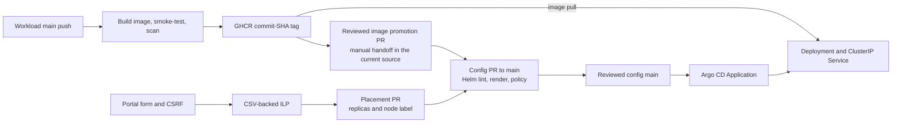

# Architecture and repository contracts

The workspace contains three independent Git checkouts. See [project state](PROJECT_STATE.md) for evidence and [development workflow](DEVELOPMENT_WORKFLOW.md) for the approval and rollback path.

| Repository | Source landmarks | Dependencies |
| --- | --- | --- |
| [Platform](../) | `portal/app.py`, `portal/github_client.py`, `portal/templates/deploy.html`, `optimizer/ilp.py`, `optimizer/data/`, `benchmarks/compare_algorithms.py` | Flask, Requests, PuLP 3.3.0 with bundled CBC, GitHub REST API. Owns shared docs and skills. The local infrastructure draft is documented in project state. |
| `gitops-platform-config` | `apps/workload-api/`, `argocd/applications/workload-api.yaml`, `.github/workflows/validate-config.yml`, `scripts/check_deployment_policies.py` | Helm, Python and PyYAML for policy checks, GitHub Actions, Argo CD and a compatible Kubernetes cluster for deployment. |
| `gitops-platform-workload-api` | `workload_api/app.py`, `Dockerfile`, `.github/workflows/ci.yml` | Flask, Gunicorn, Python 3.12 image, Docker, Trivy, GitHub Actions and GHCR. |

## Publication and placement paths

1. A push to workload `main` builds `ghcr.io/<lowercase-owner>/<repository>:<full-commit-sha>` from `GITHUB_REPOSITORY` and `GITHUB_SHA`. CI carries the image in `IMAGE` through `GITHUB_ENV`, starts a loopback-bound container, waits for `/healthz`, checks identity and version from `/`, and scans for critical vulnerabilities. Publication uses `GITHUB_ACTOR` and `GHCR_TOKEN`, which the workflow injects from `secrets.GITHUB_TOKEN`. The workflow logs the image reference in `GITHUB_STEP_SUMMARY`, with no config promotion step.
2. The portal serves `GET /` and accepts `POST /` with a session CSRF token, `replicas` in 1–3, and positive integer `max_rtt_ms`. It uses `GITOPS_CONFIG_REPO` as `owner/repo` and `PORTAL_GITHUB_TOKEN` for GitHub writes. Environment variables are read for feasible submissions. The application creates a process-local Flask session key.
3. The optimizer selects one feasible region for all replicas, subject to total CPU, memory and RTT. Its objective is hourly region price multiplied by the larger CPU or memory demand fraction. The inputs are static simulated data. The portal only proposes placement on an optimal result. The standalone multi-service benchmark compares ILP, greedy and bounded exhaustive search using aggregate region capacity and a shared scorer.
4. The portal reads config `main` and its values file at the base SHA, updates the replica and region fields, creates a UUID-suffixed branch, writes the values file with the file SHA, and opens a PR to `main`. Equal settings return a no-op. The current updater expects exactly one plain numeric `replicaCount` and a plain `idp.example.com/region` entry immediately after the `nodeSelector` line. It preserves other values, including the image tag.
5. Config PRs targeting `main` run Helm lint, chart rendering and a Python policy check for explicit image references, non-root configuration and CPU/memory requests and limits. GitHub ruleset enforcement is a separate control.
6. The Application declares automated sync from config `main` and chart path `apps/workload-api` into namespace `workloads` on the destination cluster. It requests namespace creation and leaves prune and self-heal unspecified. Cluster installation and observed reconciliation require live evidence.

## Contract ownership

| Interface | Producer and consumers | Review points |
| --- | --- | --- |
| `image.repository` and `image.tag` | Config chart renders `repository:tag` | A full commit-SHA tag names a source revision and can be reassigned in the registry. A digest identifies specific manifest content. Match published digest and intended revision, verify rendering, and retain the rollback artifact. |
| `replicaCount` and `nodeSelector.idp.example.com/region` | Portal writes config values. Chart and Kubernetes consume them. The draft playbook produces simulated labels. | Preserve values layout or coordinate migration. Verify labels, capacity, and the behavior when no node matches. |
| `GET /healthz` and container port `8080` | Workload owns the contract. CI and the chart consume it. Service port `80` uses named target `http`. | Keep readiness semantics, the Docker bind address and port mapping compatible. `GET /` returns `app` and `version`. |
| CPU and memory per replica | `optimizer/data/services.csv` uses `100` mCPU and `64` MiB. Current chart requests are `100m` and `64Mi`. | Compare units and requests when changing either side. The requests contract has no automated cross-repo check. |
| CSV datasets | `regions.csv` and `latency.csv` share region keys. `services.csv` and `benchmark_services.csv` specify demand, replicas and RTT bounds. | Keep units mCPU, MiB, ms and USD/hour. The portal default RTT shown in the form is 180 ms and the CLI fixture default is 100 ms. |

Git config `main` is desired state. Argo CD status and the running Deployment and Pods supply independent runtime evidence. A merge or a local render provides evidence about the Git revision or manifests. Observed rollout requires the Argo CD revision, sync and health plus the actual workload image identity, readiness and service smoke results.

See [ADR 0001](decisions/0001-repository-and-gitops-boundaries.md) for repository boundaries and the [proposed promotion design](IMAGE_PROMOTION.md) for reviewed admission, rollback and the future image-reference migration. The proposal is pending P0.3 approval.
