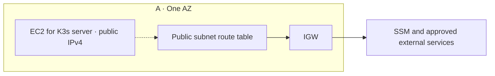
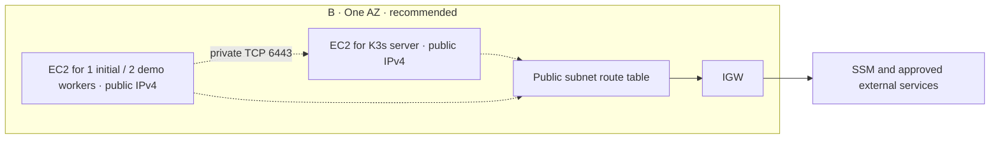
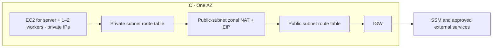

# AWS and K3s lab design

**Status** P1.5 adds the independent state bootstrap and the lab's S3 backend declaration. The initial deployment starts with Profile B and one worker, subject to owner approval at AWS-12. The final demonstration uses Profile B with one K3s server and two workers on three EC2 instances. Account, Region, AZ, AMI and spend require owner decisions. [Manual Cloud Execution Policy](../AGENTS.md#manual-cloud-execution-policy)

## Draft assessment and reuse

The eight untracked files in `infra/terraform/` and `infra/ansible/` remain the starting point. The source describes three instances. Live resources and state have not been established.

| Draft evidence | Preserve | P1.2 and later changes |
| --- | --- | --- |
| `infra/terraform/main.tf` lines 1–29, 97–122 and `versions.tf` | Named `for_each` node map, existing tags, VPC DNS, IMDSv2, encrypted gp3 roots, separate AWS provider lock. | Preserve stable node keys where possible. Start with `k3s-server` and `k3s-agent1`, with `k3s-agent2` opt-in. Make architecture, AMI, roles, sizing and storage explicit. Treat address/subnet changes on any existing state as a replacement risk. |
| `main.tf` lines 32–105 and `variables.tf` | Public subnet, IGW and route-table concepts. The existing SSH variable enforces a single IPv4 `/32`. | The draft defaults to `us-east-1`, fixes the AZ to `us-east-1a`, and gives every node a public IP, shared SG and unrestricted egress. The lab root now validates Region/AZ, selects routes by profile and uses scoped role SGs with outbound SSM. |
| `versions.tf`, `.terraform.lock.hcl`, `outputs.tf` and both ignore files | Terraform and AWS constraints, AWS lock `6.73.0`, output naming keyed by node, ignore rules for local state and inventory. | Draft lacks a remote backend and instance profiles. Add state bootstrap and locking under separate ownership, structured inventory and private output artifact handling. Cover environment-specific vars, plans, kubeconfigs and extra local inventories in a later ignore review. |
| `infra/ansible/playbooks/install-k3s.yml` lines 2–65, 67–115 and 117–139 | Server-before-agent ordering, private node/server IPs, dedicated agent join token, `no_log`, restrictive token mode, bounded readiness checks and exact placement label key. | Pin server and worker to one approved K3s version, verify publisher artifacts before privileged execution, and set repeatable OS and service configuration. The moving installer is used twice. Server version is unpinned and `creates` alone misses configuration and version drift. Validate inventory membership and cluster readiness before labels. |
| Deployment, Service and Argo CD Application in Config | Existing HTTP port, readiness probe, resource defaults, image and `idp.example.com/region` contract. | Align available placement choices with worker labels and capacity. Verify Argo CD health or pull access in a separate owner gate. Preserve staged promotion controls. |

## Single-AZ topologies

Select one profile per environment in a scoped lab account, Region and AZ. Reuse the draft VPC CIDR `10.20.0.0/16` and public subnet `10.20.1.0/24` if they clear overlap checks. Profile C adds private subnet `10.20.2.0/24` as the candidate. Also check the chosen Pod, Service and owner-access networks for overlap. Profiles A and B use public-subnet routes through an Internet Gateway, with inbound security groups restricting access. Profile C puts Kubernetes nodes in the private subnet and routes outbound traffic through one explicitly opted-in public NAT Gateway in the same AZ. All node-to-node communication uses private addresses. [K3s server network defaults](https://docs.k3s.io/cli/server)

The three diagrams show alternative declarations. Dashed links show instance placement and the intended K3s traffic. Solid links show egress routes. The graphs have been tested with mock plans.







Profile B starts with one server and one worker. For the final demonstration, set `worker_count = 2` in the reviewed deployment inputs and approve a new AWS-12 plan and AWS-13 apply. This adds `k3s-agent2` without renumbering existing instances. The draft's `t3.medium`, `t3.small` and 20 GiB gp3 roots remain sizing candidates. Measure reserves, disk growth, egress and CPU credits. Each profile uses a single control plane and AZ. [VPC NAT](https://docs.aws.amazon.com/vpc/latest/userguide/vpc-nat-gateway.html) · [K3s requirements](https://docs.k3s.io/installation/requirements)

### Instance sizing

These x86-64 candidates are starting allocations for owner review. Terraform defaults remain `t3.medium` server, `t3.small` worker and 20 GiB per root. The Config chart currently requests 100 millicores and 64 MiB per application replica. Confirm the reviewed replica count, eligible placement, limits and concurrent rollout overhead. The K3s minimum is a base OS and cluster planning input. Argo CD and observability consume additional capacity. [K3s resource profiling](https://docs.k3s.io/reference/resource-profiling) · [EC2 general-purpose instance specifications](https://docs.aws.amazon.com/ec2/latest/instancetypes/gp.html)

| Exercise | Server | Worker | Capacity decision |
| --- | --- | --- | --- |
| Minimal demonstration | `t3.medium` (2 vCPU, 4 GiB) | None | Keep to K3s, a small demo workload and a limited smoke test. Add headroom before running additional controllers. |
| Multi-node GitOps | `t3.medium` (2 vCPU, 4 GiB) | One `t3.small` (2 vCPU, 2 GiB) for bootstrap and a small app. Consider `t3.medium` (2 vCPU, 4 GiB) for the GitOps demo. | Measure K3s/system reserves and Argo CD controller, repo-server and Redis requests and reconciliation peaks. |
| Multi-node with observability | `m7i.large` (2 vCPU, 8 GiB) | One `m7i.xlarge` (4 vCPU, 16 GiB) as a sizing candidate. | Budget Prometheus memory/TSDB for series count and retention. Account for Grafana, Loki log ingestion and disk growth, and Alloy buffers and per-node collectors. Size gp3 by measured writes and retention. |
| Placement demonstration | Retain the measured GitOps or observability server sizing | One or two equal `m7i.large` (2 vCPU, 8 GiB) workers for a comparable baseline. | Add the second worker only for the approved exercise. Subtract kube/system reserves, DaemonSets and active telemetry, then test per-label allocatable CPU/RAM and eviction headroom. |

Monitor peak and steady CPU, memory, disk and allocatable capacity, including controller reconcile, image pulls and rollout surge. T3/T4g earn and spend CPU credits. Terraform leaves credit mode to AWS defaults. Standard can throttle at baseline after credits run down. Unlimited can incur surplus-credit charges. Evaluate a non-burstable choice when load is sustained. Any Graviton candidate also requires an `arm64` AMI and compatible artifacts and container images. These allocations carry no performance or price guarantee. [EC2 CPU credits](https://docs.aws.amazon.com/AWSEC2/latest/UserGuide/burstable-credits-baseline-concepts.html)

### Network and administrative access

| Flow | Scope and operational purpose |
| --- | --- |
| Owner to SSM | Owner uses short-lived IAM, an approved local Session Manager plugin, and permissions scoped to tagged lab instances and approved session documents. SSM Agent and scoped instance profile are prerequisites. |
| Ansible to EC2 through SSM | Use `amazon.aws.aws_ssm`, targeting the EC2 instance ID. The controller and instance need the prerequisites and scoped transfer bucket described in the [Terraform contract](../infra/terraform/README.md#ansible-over-ssm). |
| Worker to K3s server | The server SG admits TCP 6443 from the worker SG over private addresses. Verify TLS/SAN for the approved administrative tunnel. |
| Node mesh | Peer SG references permit UDP 8472 for VXLAN and TCP 10250 for kubelet metrics in both directions between server and worker. Worker-to-worker rules are added with the second worker. A has no node peer rules. SQLite requires no etcd peer rules. |
| Nodes to external services | Allow IPv4 TCP 443 for SSM, HTTPS registry and Git endpoints, and TCP 80 for signed package repositories. AWS handles VPC DNS and link-local time outside SG filtering. SGs do not perform domain filtering. Check exact repositories, endpoints and the pinned K3s version at the relevant owner gates. |
| Lab workload entry | Demonstrate the ClusterIP Service using an owner-authorized SSM tunnel to a node-local port forward. A/B may request TCP 80 and/or 443 for explicitly selected node roles and approved IPv4 CIDRs. C has no public application rule. |

Use a vetted regional Ubuntu AMI with working SSM Agent. Preserve IMDSv2 and use the narrowest metadata exposure compatible with the instance agent. Review separate Terraform, backend, operator and EC2 instance roles. Use encrypted EBS, explicit deletion/backup intent and no credentials in cloud-init. Public placement in Profiles A/B still requires owner review of ingress rules, egress, IPv4 charges and the teardown date. [IMDSv2](https://docs.aws.amazon.com/AWSEC2/latest/UserGuide/configuring-instance-metadata-service.html) · [K3s networking](https://docs.k3s.io/installation/requirements)

### Terraform and Ansible interfaces

- Use `infra/terraform/lab` as the lab root. It instantiates the shared networking, security, compute and IAM modules for one profile and keeps prior draft artifacts isolated. The [Terraform contract](../infra/terraform/README.md) records resource counts, security boundaries, output contracts and migration risks. EC2 attaches the routed subnet, role SGs and shared SSM profile. The owner checks AZ availability, AMI publisher and architecture, network reachability and actual role permissions.
- The separate bootstrap root manages a versioned, TLS-only SSE-S3 bucket and keeps its own encrypted local state. The lab's partial backend enables native `use_lockfile` on a distinct state key per environment. An approved recovery identity can inspect historical versions. Keep the backend after the lab teardown unless a separate decommission gate is approved. Use the [Terraform state runbook](TERRAFORM_STATE_RUNBOOK.md) for exact owner commands and distinct initialization, migration and recovery approvals. Offline verification disables the backend and uses a test-only local override in the isolated lab test copy.
- Use root output `ansible_inventory` for observed EC2 facts and stable K3s groups. Keep real inventory outside Git. P1.6 will map JSON to Ansible variables, validate freshness and arrange the separate approved S3 transfer bucket and controller access before live use.
- Label initial `k3s-agent1` as `ap-southeast-1` to preserve the current in-cluster placement contract. Keep the server outside the simulated worker pool. Before any demo, advertise only the labels actually available. Optionally add a matching label on worker 2 for a recovery drill or a distinct simulated label for a placement drill. The current CSV also names `eu-west-1` and `us-east-1`. The portal's current behavior can propose an unrepresented label. Constrain live requests or limit the fixture scenario before a guided lab exercise.
- Pin K3s version and verified artifacts on all nodes. Generate config declaratively, check effective service state and provide explicit upgrade/rollback steps. Start with single-server SQLite and test backup/restore of its database with the associated server token stored separately and securely from the agent token. For P1.8, install pinned Argo CD through an owner gate, confirm allowlisted repo, namespace, revision, pull access and health, then authorize reconciliation. Use the existing Application as the source for a reviewed bootstrap. It declares automated sync, so the owner reviews the candidate before exposing an active controller to it.

[Terraform S3 state and locking](https://developer.hashicorp.com/terraform/language/backend/s3) · [K3s backup and restore](https://docs.k3s.io/datastore/backup-restore) · [Argo CD automated sync](https://argo-cd.readthedocs.io/en/stable/user-guide/auto_sync/)

## Cost profiles

Estimates are formulas. The owner supplies approved Region-specific prices and hours, current quotas and anticipated traffic during P1.11/P1.12. Include provisioned storage, Idle/stopped resources, burst credits where applicable, unit conversions, currency and retention. Do not assume free-tier coverage or apply an estimate as a hard spending cap. Price EC2 and gp3 with the official calculator and verify NAT/IPv4/Data Transfer using the account and Region. [AWS Pricing Calculator](https://calculator.aws/) · [AWS VPC pricing](https://aws.amazon.com/vpc/pricing/) · [NAT charging](https://docs.aws.amazon.com/vpc/latest/userguide/nat-gateway-pricing.html)

| Profile | Resources and recurring drivers | Evidence and limitations |
| --- | --- | --- |
| A · Minimal (`minimal`) | One public-subnet server, one public IPv4 for outbound access, one encrypted root disk, no NAT or managed LB. | Lowest EC2 and disk count. Supports single-node bootstrap and GitOps. |
| B · Cost-optimized multi-node (`multi-node`) | One server plus one worker, optional second worker. One public IPv4 and disk per node. Private node-to-node traffic, no NAT or managed LB. | Recommended for AWS-12 owner review. Demonstrates scheduling while avoiding provisioned NAT charges. |
| C · Private network (`private`) | One server plus one or two workers in the private subnet. No public IPs on nodes. One opted-in same-AZ NAT with public IPv4, no managed LB. | Demonstrates private-subnet routing. NAT bills for provisioned time and processed traffic. Stopping instances leaves NAT and retained storage charges. |

The lab graph declares one EC2 and gp3 root in A, and two in B/C at the one-worker baseline. Adding the demo worker in B adds EC2, gp3 and a public IPv4 while reusing network and IAM resources. C alone adds a NAT Gateway and EIP. Stopping or replacing instances can leave EBS and NAT-related charges. P1.5 adds a separately managed state bucket billed for current and historical state, lock versions and requests, and any recovery transfers. Lab destroy keeps the backend. No managed LB, VPC endpoint or automatic snapshot is declared. [Lab resource counts](../infra/terraform/README.md#implemented-resource-graph) · [State retention and costs](../infra/terraform/bootstrap/README.md#retention-and-verification)

```text
Lab estimate =
  sum(instance hours * regional rate + applicable credit charges)
  + provisioned EBS GB-month and optional snapshot retention
  + public IPv4 hours * regional rate
  + NAT hours * rate + NAT processed GB * rate
  + any LB hours/capacity charges and interface endpoint hours
  + S3 state/backup storage and request charges
  + internet or inter-AZ transfer charges where applicable
  + telemetry compute, disk, retention and notification charges
```

The owner tags costs with Project, Environment, Owner and reviewed expiry, then checks budget and billing. Retention tags help track cleanup. Budget alerts notify owners and have billing delay. Use a timeboxed lab and a teardown gate for chargeable resources. NAT is useful for public sources. An endpoints-only alternative would require a tested plan for OS and K3s artifacts, GitHub and GHCR, such as approved mirrors. A managed LB or a second AZ needs its own capacity or availability justification. [AWS Budgets](https://docs.aws.amazon.com/cost-management/latest/userguide/budgets-create.html)

## Lab and future production comparison

| Aspect | Recommended lab | Future production reference |
| --- | --- | --- |
| Kubernetes, control plane and AZ | K3s on EC2, one SQLite server and one worker in one AZ with an opt-in second worker. | Managed Kubernetes, highly available control plane, multi-AZ worker pools. |
| Worker capacity | Fixed and measured. Optional second worker for selected exercises. HPA demo changes Pod counts within existing capacity. | Autoscaling worker pools and workload-specific capacity or isolated pools, with capacity and spend controls. |
| Network and egress | Public-subnet nodes with IGW egress in B. SSM-only access, scoped SGs and private node traffic. C provides the private-node NAT option. | Multi-AZ routing and egress, approved endpoints, controlled ingress and segment-specific security policies. |
| Secrets and persistence | Separate short-lived owner access; reviewed scope for deploy/pull credentials. Ephemeral workload, scoped local lab volumes and protected Terraform state. | Managed secret rotation and workload identity, durable replicated storage when required, retention and restore obligations. |
| Backup and recovery | Rebuild, restore lab state and server database only where needed. Single node/AZ recovery interrupts service. | Documented RPO/RTO, regular verified backups, recovery drills and failover design. |
| Observability | Single small stack and bounded retention, effective while lab is up. | Durable retention, resilient collection/alert delivery, on-call response and measured SLOs. |
| Cost and operations | Timeboxed non-HA lab, small role set, predictable resource inventory, manual gates. | Higher recurring costs and change complexity supported by SLAs, security, capacity and service ownership requirements. |

## Manual Execution Gate format

An actual AWS operation begins only after P1.10 offline acceptance and the matching roadmap gate decision. Placeholder artifacts and examples in the P1.1 roadmap describe planned interfaces. When real execution becomes necessary, supply a copy-ready gate using the actual reviewed working directory and commands, then wait for the owner's sanitized results.

| Field | Required content |
| --- | --- |
| Gate and scope | Milestone and gate ID, owner, task, exact working directory, Git revision, private target account/Region and environment. |
| Prerequisites | Approved short-lived role, access mode, approved budget/expiry, pinned tool versions, accepted previous gate, artifacts protected locally. |
| Commands and expectations | Exact commands without secrets, expected output/status and affected resources. For apply identify the reviewed saved plan and interactive owner approval. |
| Cost, security and failure | Expected ongoing and one-time cost, guard conditions, access scope, known risks, what stops the run and what evidence to preserve. |
| Rollback and cleanup | Revert or restore path, owners of recovery and teardown, dependencies, post-cleanup cost verification, state and backup retention. |
| Evidence to return | Redacted exit statuses, resource counts or changes, checks, costs or a sanitized failure summary. Keep secrets, account identifiers, raw plans/state, kubeconfig and private inventory in the owner's approved environment. |

See [ADR 0003](decisions/0003-private-aws-k3s-lab.md), [architecture](ARCHITECTURE.md) and the [implementation roadmap](ROADMAP.md).
