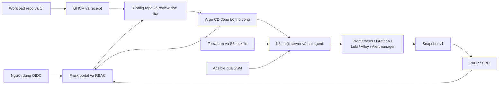

# Rà soát cuối dự án Cloud-Native Internal Developer Platform

## Kết luận

**READY để chủ dự án review bản tích hợp offline. NOT READY để kích hoạt hosted, triển khai AWS hoặc vận hành production.** Hạ tầng, GitOps, telemetry, tối ưu placement, portal và ba workload demo đã có mã nguồn, checkpoint cục bộ và kiểm thử tương ứng. Các kiểm chứng yêu cầu tài khoản, quyền hosted, hệ điều hành và công cụ cụ thể nằm ở các gate bên dưới. Chưa thực hiện thao tác AWS, chạy workflow hosted, đẩy nhánh, mở PR từ phiên này, cập nhật cài đặt GitHub, phát hành ảnh hay triển khai Kubernetes.

## Kiến trúc cuối

Platform quản lý `infra/terraform/{bootstrap,lab,modules}`, `infra/ansible`, `portal`, `optimizer`, `benchmarks`, `scripts`, `tests` và runbook. Config quản lý `apps/workload-api`, `apps/demo-jobs`, `argocd`, `observability`, guard và trạng thái promotion. Workload quản lý HTTP, metrics, worker, batch, image build/scan và receipt. Argo CD và scheduler là nơi triển khai Git đã duyệt và gán Pod. Portal chỉ đề xuất thay đổi Git. Các nguồn snapshot đã lưu và mô hình tách giá/RTT giả lập khỏi Region và AZ thật. [Kiến trúc](ARCHITECTURE.md) · [Thiết kế AWS lab](AWS_LAB_DESIGN.md)

### Hạ tầng và chi phí

Một Terraform root bootstrap sở hữu một bucket SSE-S3 theo môi trường, versioning, Object Ownership, public access block và chính sách chỉ chấp nhận TLS. Root lab dùng key dạng `terraform-state/<project>/<environment>/terraform.tfstate` và khóa kế bên `terraform.tfstate.tflock`. Lab role truy cập đúng object state và lock của môi trường, chỉ được xóa lock. EC2 role chỉ có SSM. State bootstrap được lưu cục bộ và sao lưu bảo mật theo runbook. [State và khóa](TERRAFORM_STATE_RUNBOOK.md)

| Tài nguyên lab | A tối giản | B khởi đầu | B demo cuối | C private |
| --- | ---: | ---: | ---: | ---: |
| EC2 server + worker | 1 + 0 | 1 + 1 | 1 + 2 | 1 + 1 hoặc 2 |
| VPC / Internet Gateway | 1 / 1 | 1 / 1 | 1 / 1 | 1 / 1 |
| Subnet public / private | 1 / 0 | 1 / 0 | 1 / 0 | 1 / 1 |
| Security group server / worker | 1 / 0 | 1 / 1 | 1 / 1 | 1 / 1 |
| IPv4 public gán node | 1 | 2 | 3 | 0 |
| NAT Gateway / EIP NAT | 0 / 0 | 0 / 0 | 0 / 0 | 1 / 1 có opt-in |
| Root gp3 20 GiB mặc định | 1 | 2 | 3 | 2 hoặc 3 |
| IAM role / instance profile | 1 / 1 | 1 / 1 | 1 / 1 | 1 / 1 |

Server mặc định `t3.medium`, worker `t3.small`. Đây là cấu hình khởi đầu cần xác minh credits CPU, dung lượng requests, lịch PDB, nguồn artifact và đủ bộ nhớ theo ca demo. AMI Ubuntu LTS, kiến trúc, SSM Agent, Region, subnet và lộ trình egress cần owner xác minh. Nút dùng IMDSv2 bắt buộc, gp3 mã hóa và kết nối SSM. Public IPv4 của Profile A/B hỗ trợ outbound, còn security group giữ kín SSH, Kubernetes API và overlay. C dùng NAT cùng AZ. Hai lựa chọn có chi phí khác nhau từ EC2, CPU credits, EBS, IPv4, NAT, egress và S3 requests/versioning. Observability, backups và transfer có thêm dung lượng và lưu lượng. Bucket state và EBS được giữ lại theo cài đặt vẫn có thể phát sinh chi phí sau khi hủy lab. Chưa xác minh giá hoặc hóa đơn AWS. [Graph và kích cỡ](../infra/terraform/README.md) · [Teardown](TERRAFORM_STATE_RUNBOOK.md)

## Roadmap và bằng chứng

| Mốc | Mã và xác minh cục bộ | Bằng chứng còn thiếu |
| --- | --- | --- |
| P0 | Kiểm tra provenance, scan/receipt hiện hữu. Giữ freeze và hard stop trên ứng viên hosted. Render tag/digest, pin lần đầu giữ SHA, rollback phải dùng cặp SHA/digest trong lịch sử đã duyệt. | P0.5 kiểm tra hosted từ protected base, provenance của required check, reviewer, artifact, GHCR và rehearsal rollback. Cần ủy quyền riêng. |
| P1 | Hai Terraform root, năm module, SSM/Ansible và Argo CD scope. P1.5.1 đã review độc lập trước checkpoint. Inventory v1, profile A/B/C, tests mock Windows. | P1.11–P1.16 cùng các gate bootstrap/migration. Ansible CLI và K3s runtime. Chưa xác minh mirror Linux và CI cho Terraform. |
| P2 | TLS ingress Exact, probes, Pod Security, NetworkPolicy, tài nguyên, HPA, PDB và quota. Mặc định chart vẫn dùng endpoint nội bộ và replica cố định. | CNI thực thi, cấp TLS, metrics API, HPA, drain/PDB, rollout và kiểm chứng headroom. |
| P3 | RED metrics trên workload, bộ lọc log giới hạn trường, manifest/scope observability, dashboard, rule, runbook và script tải loopback. | Render upstream packages, Collector CLI, private telemetry, alert thật, SLO và kiểm tra load/failure. |
| P4 | Snapshot v1 và adapter Kubernetes offline. CPU, memory, pod slots, reserves, vùng mô phỏng, freshness, timeout và giải thích. | Thu thập snapshot được phép, reconcile kế hoạch với scheduler, dữ liệu lớn và workload ràng buộc ngoài mô hình. |
| P5 | OIDC code/PKCE, phiên, RBAC, CSRF, catalog, preview và rollback placement, PR idempotent, audit journal, phân biệt Argo compared/synced. Mock GitHub/Argo/IdP đầy đủ cho các ca chính. | Bật writer sau review quyền bot, chính sách branch, credential, audit export, proxy TLS, IdP và trạng thái runtime thực tế. |
| P6 | Kiểm tra action pin, hard stop, image/reference và policy. Bảy ca recovery với SQLite giả lập, cú pháp runbook. | Dedicated scanner, mật mã và khôi phục live, same-server RPO/RTO và các SLO. |
| P7 | Test liên repo cho receipt, promotion/placement merge, metrics/port, code worker và CronJob. Có tài liệu demo, rollback và cleanup. | Kịch bản owner chạy từ chuẩn bị tới cleanup, revision và runtime image ID quan sát được. |

### Lệnh và kết quả đã kiểm

| Kiểm tra | Trạng thái | Bằng chứng |
| --- | --- | --- |
| `python -B scripts/terraform_offline.py --provider-mirror infra/terraform/.terraform/providers` | PASS | Terraform 1.15.5, AWS provider khóa 6.73.0. Bảy root/module validate, 111 mock plan test gồm 97 ca trước bootstrap. Mirror cục bộ, `-backend=false`, lockfile chỉ đọc, backend lab test override trong scratch. |
| `python -B -m unittest discover -s infra/terraform/bootstrap/tests` | PASS | 7 ca policy/backend/renderer. |
| `python -B -m unittest discover -s tests` | PASS | Platform 52/52 gồm 16 portal, 11 snapshot/placement, 7 recovery và 3 hợp đồng liên repo. Config 55/55, Workload 15/15. Platform trỏ vào hai worktree ứng viên bằng `PLATFORM_CONFIG_CHECKOUT` và `PLATFORM_WORKLOAD_CHECKOUT`. Dùng venv hiện có và PyYAML từ cache cục bộ. |
| `helm lint` và `helm template` | PASS | Helm 4.3.2, workload mặc định, overlay TLS private, overlay metrics và chart demo. Negative test chạy Helm kiểm tra HPA, policy, ảnh sai và manifest trùng. |
| `node --input-type=module --check` và `bash --noprofile --norc -n` | PASS | Cú pháp script k6 và 10 đoạn Bash của runbook recovery. Chưa chạy phát tải. |
| `terraform fmt -check -recursive`, Python AST, JSON, YAML, `git diff --check` | PASS | Cả ba phạm vi checkpoint. Kiểm tra mẫu khóa riêng, GitHub token và AWS access-key định dạng chuẩn trên 145 tệp đã review không có kết quả. Kiểm tra mẫu có phạm vi hẹp hơn scanner chuyên dụng. |
| `python -B -m benchmarks.compare_algorithms --snapshot optimizer/data/placement_snapshot_v1.json --as-of 2026-11-26T12:01:00Z --repeats 7` | PASS | PuLP 3.3.0 và CBC. Fixture hai workload, ba replica. CBC và exhaustive đều đạt 0,724. Greedy đạt 0,738, chênh 1,934%. Đây là điểm hàm mục tiêu có trọng số, không phải chi phí AWS. |
| Ansible CLI, Linux provider, Docker build, `actionlint`, `gitleaks`, `promtool`, k6, Alloy CLI và chart upstream | BLOCKED / NOT RUN | Ansible và các CLI tương ứng chưa sẵn dùng. WSL trả `E_ACCESSDENIED`. Docker CLI có mặt nhưng không kết nối được daemon. Mirror Linux/chart upstream chưa có gói đã duyệt trong môi trường này. Không cài công cụ hoặc thay đổi dịch vụ máy. |
| AWS IAM/S3/locking, Terraform thật, SSM, GitHub hosted, OIDC, TLS, Kubernetes, restore | NOT RUN | Cần gate và bằng chứng owner. Toàn bộ test hạ tầng dùng mock hoặc fixture. |

Các lần fail trong phát triển đã được tái hiện và sửa, gồm copy thiếu tfvars mẫu trong runner, thiếu PyYAML khi dùng môi trường mặc định, selector và HPA mơ hồ, nhánh PR đổi SHA, Argo renderer ngoài hợp đồng và manifest trùng. Scope code đã kiểm tra whitespace trước từng commit. Kết quả live, hosted và production giữ trạng thái riêng. [Nhật ký](EXECUTION_LOG.md) · [Quality gates](QUALITY_GATES.md)

## Bảo mật và giới hạn

- Giữ lại block lịch sử của image v2. Guard hosted chuẩn bị kiểm tra exact merge candidate, bước scan/receipt, provenance, digest, independent reviewer và kết quả Helm trong thư mục cô lập. Reviewer vẫn phải xác minh các đường deploy bên ngoài chart workload. Phần pin đầu tiên cần receipt đủ điều kiện cho đúng SHA hiện hành. Nếu không có receipt, giữ rollout hiện tại và dừng gate. [Promotion](PROMOTION_RUNBOOK.md)
- IAM state, EC2/SSM, Terraform executor, Ansible controller, GitHub bot và người review có phạm vi riêng. Token trao đổi OIDC, join token, state, plan và inventory thật nằm ngoài source. Journal cục bộ cần chuyển vào kho lưu giữ đã duyệt và kiểm soát chỉnh sửa trước khi dùng chung. [Bảo mật](SECURITY.md) · [Portal](../portal/README.md)
- Mô hình K3s một server và một AZ chưa có control-plane failover. Restore đã thử trên SQLite tổng hợp. Runbook same-server có mục tiêu RPO 24 giờ và RTO 60 phút chưa đo. Mất host, AZ và workload volume là các kịch bản riêng. [Khôi phục](RECOVERY_RUNBOOK.md)
- Cho đến khi có test live, không coi HPA/TLS/NetworkPolicy, xác minh identity của GitHub App và cài chart observability đã được chứng minh. Benchmark kiểm tra fixture; bộ điều phối vẫn xét điều kiện Kubernetes thực. [Demo](DEMONSTRATION.md)

## Checkpoint Git

| Repo | Nhánh và mốc đối chiếu | Commit cục bộ |
| --- | --- | --- |
| Platform | `feat/provision-aws-k3s-infrastructure`, merge base `ae2664c`, cached `origin/main` là `1f5233a` | `860319f` Terraform; `dce69af` Ansible; `57807b5` runner; `08ceda8` placement; `bde941b` portal; `c7d63ac` recovery; `ad819b7` tích hợp. Báo cáo được ghi trong commit tài liệu tiếp theo. |
| Config | `feat/offline-config-lab` từ cached `origin/main` `1bd7f2a` | `bfc7134` chart/guard; `b50a5c5` observability; `e06b9a1` demo chart; `59a61aa` ứng dụng Argo demo tùy chọn. |
| Workload | `feat/offline-workload-lab` từ cached `origin/main` `406b6d3` | `10bb5fa` telemetry; `626f62b` demo sources. |

Config và Workload dùng worktree riêng dưới thư mục tạm của hệ thống. Workload gốc vẫn ở `e21e077`, Config gốc ở `9564111`. Hai chuẩn cached vẫn cần đối chiếu lại khi được phép làm việc với remote. Platform đang chênh ba commit so với cached main ở phía main, cần review ancestry trước khi phát hành PR. Không reset, rebase, force-push, xóa ref, gián đoạn worktree review hoặc ghi đè draft hạ tầng cũ. Không đưa workflow đang sửa ở Workload gốc vào ứng viên. Ứng viên kế thừa hai hard stop từ cached main. [Nhật ký](EXECUTION_LOG.md)

## Trình tự AWS, demo và rollback

1. Review tài khoản/Region và budget, áp dụng bootstrap riêng, xác minh state/locking, duyệt migration nếu có state cũ, sau đó duyệt riêng lab plan và apply. Dùng Profile B một worker lúc đầu.
2. Owner xác minh SSM, AMI và bucket truyền riêng. Chạy baseline và bootstrap với SHA/version đã duyệt, rồi kiểm tra cả lần chạy thứ hai. Duyệt thêm worker thứ hai trước demo.
3. Hoàn thành hosted P0.5 trước bất kỳ kích hoạt publication, preview hoặc ghi của portal. Review image, sync Argo thủ công, đo private HTTP, triển khai telemetry và job đã duyệt. Thu bằng chứng runtime image ID, revision, readiness, deny path và alert.
4. Hoàn tác qua Git, luôn ghi lại revision và xác nhận Argo đã sync. Xử lý rollback image riêng với block/generation và digest từ lịch sử đáng tin cậy. Khôi phục SQLite và xác minh lại workload theo cửa sổ đã duyệt. Duyệt destroy lab riêng. Backend và backup được giữ lại hoặc decommission qua gate riêng sau đối chiếu chi phí.

[Manual gates và lệnh owner](MANUAL_AWS_GATES.md) · [Kịch bản demo](DEMONSTRATION.md) · [Runbook recovery](RECOVERY_RUNBOOK.md)

## Pull Request drafts

### English

#### Summary
Platform `feat/provision-aws-k3s-infrastructure → main` delivers the offline lab and developer portal. Config `feat/offline-config-lab → main` delivers hardened private workloads, digest-aware checks, observability and demo manifests. Workload `feat/offline-workload-lab → main` delivers measured HTTP telemetry and worker/batch code. The exact cached ancestry and candidate commits appear in the checkpoint table. Confirm live base and head with separate authorization before opening any PR.

#### Changes
Platform adds provider-locked VPC/EC2/SSM/IAM and protected S3 state, pinned K3s bootstrap, versioned placement, authenticated proposals, and SQLite recovery rehearsal. Config adds scoped Argo CD, optional private TLS and policy, HPA/PDB, OCI digest support, internal alerts and restricted probe manifests. Workload adds internal RED counters, bounded structured logs, and two probe commands on the existing non-root image.

#### Technical implementation
Initial Profile B uses one server and one worker. The final demo adds the second worker. State uses a native S3 lock and environment-scoped object keys. Placement solves a shared discrete model under CPU, memory, Pod slots and single-region-per-workload constraints. Portal revalidates signed preview, base commit, rendered scope, app identity and GitHub bot provenance before submitting a proposal. Config binds source SHA and OCI digest, keeps the current SHA on first pin, and only permits pinned rollback to an eligible historic pair.

#### Impact and compatibility
The default tag and two-resource workload render remain compatible. Existing readiness, namespace and labels remain stable. Placement only changes supported fixed replica fields and refuses effective Helm overrides. The demo chart and optional infrastructure remain opt-in. The code in Workload must be built and published under separate approval before enabling the demo chart.

#### Security considerations
No AWS or hosted operation was executed. Freeze remains active, and both Workload hosted hard stops are inherited. IAM, SSM transfer, portal bot, TF state, human reviewer and workload trust remain scoped. A reviewed retained audit sink and independent branch rules remain activation gates.

#### Validation
111 Terraform mock plans, seven bootstrap tests, Platform 52/52, Config 55/55 and Workload 15/15 passed. Helm and cross-repo contract checks passed. CBC and exhaustive both scored 0.724 on the simulation fixture. Cloud deployment, hosted checks, Linux Ansible runtime and dedicated scanning remain pending.

#### Deployment and rollback
Run identity and state gates before lab apply. Approve SSM/K3s and manual Argo sync separately. Verify the approved publication receipt before pinning and load the exact digest for the demo. Roll back with a reviewed Config change and verify the observed revision and digest. Run separately approved recovery and cleanup gates.

#### Risks and limitations
The lab has one AZ and one control-plane server. Ansible, network enforcement, scaling, third-party observability charts, IdP/Argo hosted integration and measured recovery still require live evidence. Config/Workload bases are cached and Platform diverges from its cached main.

**Review checklist**

- [ ] Verify the proposed base, candidate commits, protected workflow publisher and independent review.
- [ ] Review real identity, scopes and billable changes at the manual gates.
- [ ] Keep hosted locks closed pending evidence. Validate runtime revision, digest, observability and rollback in the approved lab.

#### References
[Roadmap](ROADMAP.md) · [Quality gates](QUALITY_GATES.md) · [Manual execution](MANUAL_AWS_GATES.md) · [Demo](DEMONSTRATION.md)

### Tiếng Việt

#### Tóm tắt
Platform `feat/provision-aws-k3s-infrastructure → main` cung cấp lab offline và portal. Config `feat/offline-config-lab → main` cung cấp workload private đã harden, guard digest, observability và manifest demo. Workload `feat/offline-workload-lab → main` bổ sung telemetry HTTP và mã worker/batch. Bảng checkpoint ghi ancestry cache và commit ứng viên. Xác minh lại base/head thật sau khi được phép và trước khi mở PR.

#### Các thay đổi
Platform bổ sung VPC/EC2/SSM/IAM với provider đã khóa, S3 state được bảo vệ, K3s theo phiên bản cố định, placement phiên bản hóa, đề xuất xác thực và diễn tập SQLite. Config bổ sung Argo CD giới hạn, TLS private, policy, HPA/PDB tùy chọn, OCI digest, alert nội bộ và manifest probe hạn chế. Workload thêm RED metrics nội bộ, log giới hạn trường và hai lệnh probe vào image non-root hiện có.

#### Chi tiết triển khai kỹ thuật
Profile B bắt đầu với một server và một worker. Demo cuối bổ sung worker thứ hai. State dùng khóa S3 native và key tách môi trường. Placement giải cùng mô hình rời rạc theo CPU, memory, số Pod và một vùng trên mỗi workload. Portal kiểm lại preview đã ký, base commit, phạm vi render, danh tính App và bot GitHub trước khi gửi đề xuất. Config ràng buộc SHA nguồn với OCI digest, giữ SHA ở lần pin đầu và chỉ rollback digest về cặp hợp lệ trong lịch sử.

#### Ảnh hưởng và tương thích
Tag mặc định và chart render hai tài nguyên vẫn tương thích. Readiness, namespace và labels ổn định. Placement chỉ sửa trường replica cố định, từ chối override Helm có hiệu lực. Chart demo và hạ tầng tùy chọn phải bật rõ ràng. Mã Workload cần được build và publish sau khi được phép riêng trước khi bật chart demo.

#### Bảo mật
Không thực hiện AWS hoặc hosted. Freeze giữ nguyên, ứng viên Workload kế thừa hai hard stop. IAM, truyền tệp SSM, bot portal, Terraform state, reviewer và workload giữ quyền riêng. Kho audit lưu giữ đã duyệt và ruleset giới hạn ghi cần hoàn tất trước khi kích hoạt.

#### Kiểm thử và xác minh
111 Terraform mock plan, bảy ca bootstrap, Platform 52/52, Config 55/55 và Workload 15/15 đạt. Helm và hợp đồng liên repo đạt. CBC và exhaustive cùng đạt 0,724 trên fixture mô phỏng. Triển khai cloud, hosted, Ansible Linux runtime và scanner chuyên dụng đang chờ.

#### Triển khai và khôi phục
Thực hiện gate danh tính và state trước lab apply. Duyệt riêng SSM/K3s và sync Argo thủ công. Kiểm receipt đã duyệt trước pin và dùng đúng digest cho demo. Rollback qua thay đổi Config đã review, xác minh revision và digest quan sát. Thực hiện gate recovery và cleanup đã được duyệt riêng.

#### Rủi ro và giới hạn
Lab một AZ và một control-plane server. Ansible, thực thi mạng, scaling, chart observability upstream, IdP/Argo hosted và thời gian phục hồi cần bằng chứng live. Config/Workload dùng base cache và Platform có ancestry khác cached main.

**Checklist review**

- [ ] Đối chiếu base, commit, publisher của check bảo vệ và phê duyệt độc lập.
- [ ] Review danh tính, phạm vi và thay đổi tính phí tại các gate thủ công.
- [ ] Giữ các khóa hosted cho đến khi đủ bằng chứng. Xác minh revision, digest, observability và rollback trong lab đã duyệt.

#### Tham chiếu
[Roadmap](ROADMAP.md) · [Quality gates](QUALITY_GATES.md) · [Gate thủ công](MANUAL_AWS_GATES.md) · [Demo](DEMONSTRATION.md)

## Tóm tắt portfolio và CV

Thiết kế và triển khai offline nền tảng GitOps trên AWS/K3s với Terraform khóa version và S3 locking, SSM/Ansible, OCI promotion có xác minh độc lập, quan sát dịch vụ, bộ tối ưu ILP và portal có RBAC. Phối hợp hợp đồng qua ba repo, chạy 111 ca Terraform mock, 122 ca regression Python liên repo và bảy ca bootstrap riêng, dựng benchmark có thể phát lại và diễn tập khôi phục SQLite với fixture. Phạm vi minh chứng hiện tại là kiểm chứng cục bộ. Các kết quả hosted, AWS và production nằm trong gate tách riêng.
