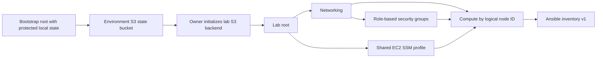

# P1.5.1 · Terraform integration and security review

The offline review covered the lab and bootstrap roots, the five child modules, inventory v1 and the owner state runbook. Platform HEAD at the start of review was `ae2664c` on `feat/provision-aws-k3s-infrastructure`. The Terraform implementation was present in the working tree. The original root draft and its lock remained in place. There was no staged diff. P1.5.1 made no commit or ref changes.

## Deployment graph

| Profile | Stable nodes | Node subnet | Node public IPv4 | NAT / NAT EIP | Role security groups |
| --- | --- | --- | ---: | --- | ---: |
| A minimal | Server | Public | 1 | 0 / 0 | 1 |
| B initial | Server, agent1 | Public | 2 | 0 / 0 | 2 |
| B final demo | Server, agent1, agent2 | Public | 3 | 0 / 0 | 2 |
| C private | Server, agent1, optional agent2 | Private | 0 | 1 / 1 with opt-in | 2 |

Each node has one encrypted gp3 root volume and requires IMDSv2 with hop limit one. Each profile uses one shared EC2 role and instance profile. B's second worker adds one EC2 instance, root volume and public IPv4 plus rules for worker-to-worker traffic. Existing network, instance addresses and role groups stay keyed the same. All profiles export `k3s`, `k3s_server` and `k3s_agents` groups with SSM instance IDs. C exports null public IPs. The simulated placement labels remain separate from the EC2 Region and AZ. [Resource and module contracts](../infra/terraform/README.md)

## Findings and changes

| Finding | Resolution | Remaining verification |
| --- | --- | --- |
| A condition requiring `s3:prefix` on every `s3:ListBucket` authorization could prevent Terraform from recognizing an absent state object. The pinned client uses `HeadObject` without a list prefix and handles a not-found result as absence. | Use `StringEqualsIfExists` for that one ListBucket statement on the exact environment bucket. Object access stays limited to exact state and lock keys. The normal and recovery identities can enumerate object names in that bucket by omitting the prefix. Keep unrelated objects out of it. | Verify the actual role and fresh initialization at AWS-12-L1. |
| The runbook required approved backend and variable fingerprints but the init, migration and plan snippets assumed the owner had compared them. | Reuse `Assert-Hash` through `Assert-LabBackendInputs` in those three gates. The approved inputs come from the AWS-12-L0 record. | The owner must carry the recorded fingerprints into the protected execution session. |

[AWS HeadObject permissions](https://docs.aws.amazon.com/AmazonS3/latest/API/API_HeadObject.html) · [Terraform 1.15.5 S3 client](https://github.com/hashicorp/terraform/blob/v1.15.5/internal/backend/remote-state/s3/client.go) · [IAM condition operators](https://docs.aws.amazon.com/IAM/latest/UserGuide/reference_policies_elements_condition_operators.html)

The bootstrap root creates one bucket and five controls, with versioning, SSE-S3, all four public access blocks, bucket-owner-enforced object ownership and an explicit deny for non-TLS requests. `prevent_destroy` guards the reviewed configuration. `force_destroy = false` keeps Terraform from emptying the bucket. Retain state history and use a separate recovery role for exact-key version reads. Only the lock path permits normal `DeleteObject`. The EC2 role attachment is the SSM managed-node policy only. The bootstrap and Ansible identities are separate, and the dedicated Ansible transfer bucket is outside the Terraform state path. Review effective permissions, including attached managed policies, session policies and account restrictions, before execution. [Bootstrap policy and custody](../infra/terraform/bootstrap/README.md) · [Owner state runbook](TERRAFORM_STATE_RUNBOOK.md)

## Verification

The seven suites used Terraform 1.15.5 for Windows amd64 and the locally mirrored AWS provider 6.73.0. The lab, bootstrap and historical draft lockfiles matched byte for byte. The local test copies excluded real input/artifacts and initialized with fresh `TF_DATA_DIR` directories, the local mirror and readonly lock. AWS/TF environment overrides were cleared, empty AWS configuration files were supplied and IMDS and checkpoint were disabled. The production lab backend was validated with `-backend=false`. A test-only local backend override was used only in the isolated lab copy for its test suite. All AWS test files declare `mock_provider "aws"` and all 111 runs use `command = plan`.

| Command or check | Outcome |
| --- | --- |
| `terraform fmt -check -recursive -no-color infra/terraform` | PASS. |
| `terraform init -backend=false -lockfile=readonly -input=false -plugin-dir=<local mirror>` and `terraform validate -no-color` | PASS for lab, bootstrap, inventory, compute, IAM, networking and security. |
| `terraform test -no-color` | PASS. Lab 49, bootstrap 14, inventory 9, compute 11, IAM 8, networking 8 and security 12. |
| `python -B -m unittest discover -s infra/terraform/bootstrap/tests -p 'test_*.py' -v` | PASS, 7 static and renderer cases. |
| Python JSON and PyYAML parsers | PASS for 8 Terraform JSON examples/fixtures and 6 then-present Ansible YAML files. |
| PowerShell parser on the runbook | PASS, 16 command snippets parsed without execution. |
| `git diff --check` and whitespace checks on touched untracked source | PASS. Git reported existing line-ending conversion notices. |
| Artifact ignore and targeted secret patterns | PASS. State, plans, live backend vars, crash logs and live inventory names are ignored, and locks and fixtures remain eligible. No matching credential pattern across the 49 inspected source, example and fixture files. |
| Real-provider planning, backend initialization, locking, migrations and AWS IAM behavior | NOT RUN. Owner gates only. |

The regression first failed as expected in `backend_keys_and_exact_identity_policies` with the previous condition. The same full-policy assertion passed after the fix, together with all other mock cases. Actual AWS calls, access to AWS credentials and inspection of existing state contents were outside this review.

## Readiness

**PASS for the P1.5.1 offline review.** The isolated tests cover the stated profile and policy contracts. Git checkpoint decisions belong to the project integration workflow.

**AWS deployment pending.** The owner must verify account and bucket ownership, effective role permissions, S3 fresh init, locking, migration as applicable and an approved plan. Cloud compatibility, SSM registration and actual costs remain owner evidence. Distinguish the initial B1 plan from final B2 capacity and verify changes to subnet, AMI, profile or storage against the approved plan before applying. No cloud gate was executed during this review. [Owner state runbook](TERRAFORM_STATE_RUNBOOK.md)
