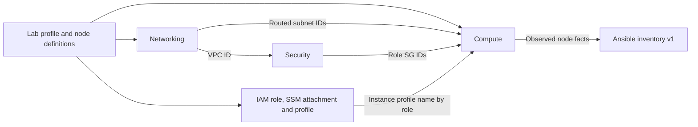

# Terraform foundation and lab contracts

Use [lab/](lab/) as the environment root. It selects one profile and calls reusable Networking, Security, Compute, IAM and Ansible inventory modules. [Bootstrap](bootstrap/README.md) manages S3 state independently. Start with Profile B and one worker at the owner's AWS-12 planning gate. The final demonstration uses Profile B with `worker_count = 2`, for one K3s server and two workers. The default worker count and Profiles A and C remain available. [AWS lab design](../../docs/AWS_LAB_DESIGN.md)

## Baseline and reuse

The original root directly under this directory is a historical snapshot. Keep its source and existing local artifacts for later owner review. Run tests from an isolated copy of the lab and child modules.

| Draft | P1.2 contract |
| --- | --- |
| `versions.tf` required Terraform `>= 1.5.0`, AWS `~> 6.0` and default Project, Environment and ManagedBy tags. The AWS lock selected `6.73.0`. | Terraform `>= 1.10.0, < 2.0.0` supports cross-variable validation, provider mocks and the planned S3 native locking. Tested on installed `1.15.5` for Windows amd64. AWS constraint and lock selection/hashes are preserved. The lab root owns a byte-identical lock. |
| `main.tf` put three nodes in a public subnet in `us-east-1a`, with public IPs, VPC DNS, IGW/default route and one shared node SG. Internal rules use TCP 6443, UDP 8472 and TCP 10250. Egress allows all protocols. | The lab root uses profile-specific routing and role SGs from P1.3. Compute uses the stable node keys, instance types and root disk defaults from P1.2. |
| `variables.tf` exposed `aws_region` (default `us-east-1`), `ubuntu_ami_id`, `admin_cidr` (/32) and `ssh_public_key_path`. The SSH SG rule and key pair used the latter inputs. | Lab requires Region/AZ and pinned `ami.id`. The new contract has SSM as its sole administration mode and no inbound management configuration. |
| `outputs.tf` exposed `public_ips` and `private_ips` keyed by node. The Ansible draft uses `k3s_server`, `k3s_agents`, `k3s`, `node_private_ip` and `simulated_region`. | The separate `ansible-inventory` module produces versioned inventory from observed compute facts while retaining node and group names. The original outputs and playbook remain available in the draft. |

## Environment inputs

| Input | Type and behavior |
| --- | --- |
| `project_name`, `environment` | Strings defaulting to `gitops-platform` and `lab`. Lowercase hyphen-separated alphanumeric segments starting with a letter, up to 32 and 16 characters respectively. |
| `aws_region`, `availability_zone` | Required standard Region and one AZ in that Region, checked offline for format. Confirm actual account-specific AZ availability and identity at the manual gate. |
| `lab_profile`, `worker_count` | String and whole number. `minimal` needs 0 workers. `multi-node` (default) and `private` need 1 (default) or 2 workers. Every profile has one server. |
| `network` | Object with `vpc_cidr` (default `10.20.0.0/16`), `public_subnet_cidr` (default `10.20.1.0/24`), and `private_subnet_cidr` (required only for C). Canonical IPv4 CIDRs with /16 through /28 prefixes. Subnets must fit within the VPC and have no mutual overlap. Review overlap with owner and Kubernetes networks at the gate. |
| `nat_gateway_enabled` | Boolean defaulting to false. C requires true to opt in to the same-AZ public NAT Gateway. A/B require false and use an IGW and one public IPv4 per node for egress. |
| `ami` | Required `{id, architecture?}` object. The ID is pinned and Region-specific. Architecture defaults to `x86_64` and also supports `arm64`. Verify AMI publisher, OS and SSM Agent, architecture and EC2 family compatibility at the gate. |
| `server`, `worker` | Objects with optional `instance_type` (defaults `t3.medium` and `t3.small`) and `root_volume` (whole `size_gib` 1–16384, default 20, and `delete_on_termination`, default true). Encrypted gp3 and IMDSv2 are required. Set a disk size at least as large as the approved AMI root snapshot. `worker.simulated_regions` optionally overrides placement labels by stable worker ID. |
| `administrative_access`, `public_ingress` | Administration accepts only `ssm`. Application ingress defaults to null. A/B can opt in via nonempty `source_cidrs` and `ports` sets plus `node_roles` containing `server` and/or `worker` when that role exists. P1.2 inputs with omitted or empty roles remain valid and create no rules. Only TCP 80/443 and canonical IPv4 sources are accepted. The sum of input CIDR sizes must be less than the full IPv4 space. C requires null. |
| `cost_allocation`, `resource_tags` | Required nonempty `owner` team alias and `cost_center` strings. Optional map of up to 43 extra tags. Extra tags cannot override Project, Environment, Owner, CostCenter, ManagedBy, Name or Role. |

[Example inputs](lab/examples/) use a synthetic AMI and exercise each profile in tests. Choose and review one example before preparing a private `.tfvars` file. Credentials belong in the operator's short-lived authentication flow. Managed load balancers, paid interface endpoints, telemetry retention and other optional recurring-cost resources require separate opt-in and review. A/B public IPv4 charges are inherent to those profiles.

## Module contracts

Use the same modules for all profiles. The root selects the profile once and derives `network_topology`, `access` and `node_definitions`. The root exposes `network`, `security`, `iam`, `nodes` and `ansible_inventory` for machine-readable verification.



| Module | Inputs | Outputs and consumer |
| --- | --- | --- |
| [Networking](modules/networking/) · implemented | `name_prefix: string`, `tags: map(string)`, and typed `network_topology` from the root. It contains profile, VPC and subnet CIDRs, AZ, node subnet key, egress, public IPv4 intent and NAT opt-in. | `vpc_id`, `vpc_cidr`, `public_subnet_id`, `private_subnet_id`, `public_route_table_id`, `private_route_table_id`, `internet_gateway_id`, `nat_gateway_id`, `availability_zone`, `lab_profile`, `node_subnet_key`, `node_subnet_id` and `expected_egress` are strings. Private subnet, private route table and NAT IDs are null in A/B. `subnet_ids` and `route_table_ids` are string maps that omit unused roles. `topology` echoes typed intent. |
| [Security](modules/security/) · implemented | `vpc_id`, `name_prefix`, `tags`, `administration = "ssm"`, `lab_profile`, `worker_count`, `node_communication` and nullable `public_ingress`. Communication has the API, VXLAN and kubelet ports plus Flannel backend and Metrics Server flags. Activated ingress requires source CIDRs, ports and nonempty node roles. | `server_security_group_id: string`, `worker_security_group_id: string\|null`, `security_group_ids_by_role: map(list(string))` and effective `policy`. `application_security_group_id` is null because the selected node groups receive the optional rules directly. |
| [Compute](modules/compute/) · implemented | `node_definitions` map with role, name, instance type, AZ, subnet key, public IPv4 intent, IMDSv2, encrypted storage, tags and optional simulated region. Also pass `subnet_ids: map(string)`, `security_group_ids_by_role: map(list(string))`, `ami: object({id = string, architecture = string})` and `instance_profile_names_by_role: map(string)`. | `nodes` is keyed by logical ID. Each node contains `logical_id`, `role`, `instance_id`, `private_ip`, `public_ip` (null in C), `availability_zone`, `instance_type`, `subnet_id`, `security_group_ids` (sorted string list), `instance_profile_name` and nullable `simulated_region`. |
| [IAM](modules/iam/) · implemented | `project_name`, `environment`, `aws_region`, tags, `administration = "ssm"`, active `node_roles: set(string)` and `required_permissions = ["ssm-managed-node"]`. | `instance_profile_names_by_role`, `instance_profile_arns_by_role` and `role_arns_by_role` are string maps. Active roles point to a shared profile and role. `ssm_policy_arn` identifies the sole declared permission attachment. |
| [Ansible inventory](modules/ansible-inventory/) · implemented | `environment`, `aws_region`, `availability_zone`, `lab_profile` and the Compute node map. | Root `ansible_inventory` emits schema v1 from observed EC2 facts. The typed module projects only inventory v1 fields. Integrated tests compare all three results to the original fixtures. |

## Implemented resource graph

Each AWS child module contains `versions.tf`, `variables.tf`, `main.tf`, `outputs.tf` and a standalone mock test under `tests/`. The lab owns the provider lock and has [network/security tests](lab/tests/network-security.tftest.hcl) and [compute/IAM/inventory tests](lab/tests/compute-iam.tftest.hcl).

| Terraform-managed resource | A | B (one / two workers) | C (one / two workers) |
| --- | ---: | ---: | ---: |
| VPC with both DNS flags | 1 | 1 | 1 |
| Public subnet / private subnet | 1 / 0 | 1 / 0 | 1 / 1 |
| Internet Gateway | 1 | 1 | 1 |
| Route tables / default routes / subnet associations | 1 / 1 / 1 | 1 / 1 / 1 | 2 / 2 / 2 |
| Zonal public NAT Gateway / VPC Elastic IP | 0 / 0 | 0 / 0 | 1 / 1 |
| Server SG / worker SG | 1 / 0 | 1 / 1 | 1 / 1 |
| Internal ingress rules / internal egress rules | 0 / 0 | 5 / 5 or 7 / 7 | 5 / 5 or 7 / 7 |
| Web egress rules | 2 | 4 | 4 |
| Application ingress rules by default | 0 | 0 | 0 |
| EC2 instances | 1 | 2 / 3 | 2 / 3 |
| Encrypted gp3 roots, nested in EC2 | 1 × 20 GiB | 2 / 3 × 20 GiB | 2 / 3 × 20 GiB |
| Automatically assigned node public IPv4 addresses | 1 | 2 / 3 | 0 |
| IAM role / instance profile / policy attachment | 1 / 1 / 1 | 1 / 1 / 1 | 1 / 1 / 1 |
| Terraform resource addresses with default ingress | 13 | 27 / 32 | 33 / 38 |

Optional app ingress adds one rule per approved role, port and CIDR. The address totals exclude nested EBS roots, node public IPs, AWS-created VPC defaults and the independently managed state bucket. Compute creates no separate EBS volume, node EIP, managed load balancer, endpoint or snapshot. The root volume count assumes the owner approves a root-only EBS-backed AMI.

| Table and association | Profiles | Implicit VPC route | Terraform-managed IPv4 default |
| --- | --- | --- | --- |
| Public table → public subnet | A, B, C | Configured VPC CIDR → local | `0.0.0.0/0` → lab IGW |
| Private table → private subnet | C | Configured VPC CIDR → local | `0.0.0.0/0` → zonal public NAT in the public subnet |

Both subnets disable subnet-wide public IPv4 auto-assignment. Compute consumes the route-ready `subnet_ids` map, rule-ready `security_group_ids_by_role` and the SSM instance profile. It explicitly enables instance public IPv4 for A/B and disables it for C. The IAM profile depends on the SSM policy attachment. The owner still needs to verify IAM propagation and SSM registration after approved provisioning.

### Network traffic matrix

The initial lab uses a single K3s server with SQLite, Flannel VXLAN and the bundled Metrics Server. The draft already selects VXLAN and its server version is unpinned. P1.7 will pin the version and verify that these flows match its effective configuration. A has no inter-node SG rules. B and C use SG references scoped to private addresses.

| Source | Destination | Protocol and port | When and why |
| --- | --- | --- | --- |
| Worker SG | Server SG | TCP 6443 | B/C. Worker registration, supervisor and Kubernetes API. |
| Server SG ↔ worker SG, worker SG → worker SG | Peer node SG | UDP 8472 | B/C with VXLAN. Worker-to-worker requires two workers. |
| Server SG ↔ worker SG, worker SG → worker SG | Peer node SG | TCP 10250 | B/C with Metrics Server connectivity enabled. Worker-to-worker requires two workers. |
| Server and worker SGs | IPv4 destinations | TCP 443 | SSM, GitHub, GHCR, HTTPS registries and OS repositories. |
| Server and worker SGs | IPv4 destinations | TCP 80 | HTTP package mirrors and repository redirects. Require signed packages and artifact verification. |
| Approved source IPv4 CIDRs | Explicitly selected server and/or worker SG | TCP 80 and/or 443 | Optional for A/B. A can target only server. |
| Node | AmazonProvidedDNS, Amazon Time Sync Service | VPC DNS, link-local NTP | AWS handles these services outside SG rule filtering. |

AWS security groups are stateful. Internal peer flows above have matching scoped egress and ingress. Responses to allowed flows need no reverse rule. There are no public ingress rules for SSH, Kubernetes API, kubelet, etcd, NodePort or admin dashboards. SQLite requires no etcd peer traffic. The two broad IPv4 egress ports support rotating service destinations. They allow any reachable IPv4 destination on those ports and provide no domain filtering. The lab uses the VPC resolver and Amazon Time Sync. A custom DNS, NTP, registry or CNI path needs separate review. [K3s network requirements](https://docs.k3s.io/installation/requirements#networking) · [AWS security groups](https://docs.aws.amazon.com/vpc/latest/userguide/vpc-security-groups.html)

Use the workload ClusterIP through an owner-authorized Session Manager tunnel to a node-local Kubernetes port forward for the first demonstration. Review ingress controller binding and TLS separately before enabling the optional CIDR rules. Confirm rule quotas for the approved list of app CIDRs, and verify registry pull, package mirror and pod-to-kubelet paths when the pinned image and K3s configuration are available.

## Stable identity and profile changes

The root's node map contains `k3s-server` and consecutive slots `k3s-agent1`, `k3s-agent2`. Roles are `server` and `worker`. Keep these keys as Terraform `for_each` identities and Ansible/K3s host names. Use `<project>-<environment>-<logical-id>` as the EC2 resource name and Name tag. The second worker reuses the networking and worker SG addresses and adds the worker-to-worker VXLAN and kubelet rules. Removing a slot removes that worker and may delete its root volume under its configured retention setting.

A to B can retain the public-subnet server key while adding workers. Workload eligibility and labels must be reconciled when moving between single-node and multi-node profiles. Moving between B/A and C changes subnet placement and public addressing and can replace nodes. Changes to Region, AZ, subnet/VPC CIDRs, AMI or module resource addresses also require review for replacement or state migration. The draft's `aws_instance.k3s["<logical-id>"]` would have a different resource address after extraction into a child module. If the owner confirms existing infrastructure, compare the actual state privately and approve the mappings, replacement impact, backup and rollback before a separate migration. Keep environments on separate state keys.

Network resource addresses use `public` and `private` role keys. Entry to C adds its private subnet, route table, association and NAT/EIP. Leaving C removes that graph. Turning off NAT while staying on C is invalid. An AZ or subnet CIDR change can replace a subnet and its dependent resources. Public subnet replacement affects the zonal NAT. Replacing a VPC or changing a role SG's name can replace its SGs and require attachment updates. The original draft used different network and instance addresses. Any state reuse requires owner-reviewed mapping from `aws_instance.k3s[logical-id]` to `module.compute.aws_instance.node[logical-id]`, plus a separate access transition.

Treat AMI, subnet and AZ changes as replacement candidates. Supported instance type changes may stop and restart a node. EBS expansion and some EBS or metadata setting changes may update in place. Root shrink, encryption-key changes, profile changes and IAM profile renames need explicit review for replacement, restart, reattachment or temporary SSM loss. Terraform applies no blanket lifecycle overrides. Use the later real-provider plan to determine the operation for a particular revision and deployment.

## Compute security and storage

Choose an owner-approved Ubuntu LTS EBS-backed AMI, preferably Ubuntu 24.04 LTS, with one root mapping, a maintained enabled SSM Agent, instance-architecture support and no baked-in keys or credentials. Use one pinned Region-specific ID. Confirm systemd, Python 3, curl, CA certificates, cgroups, kernel networking and the pinned K3s/Ansible versions at the owner gates. Offline tests validate ID shape and `x86_64` or `arm64`. They reject mismatches for the known `t2`, `t3`, `t3a`, `m7i`, `t4g` and `m7g` families. Other types remain configurable and require manual verification. Verify image identity, actual architecture, root snapshot size, additional mappings, instance availability and launch permissions at AWS-11. [K3s requirements](https://docs.k3s.io/installation/requirements)

Each instance has a host IPv4 IMDS endpoint for SSM Agent with `http_tokens = "required"`, `http_put_response_hop_limit = 1`, `http_protocol_ipv6 = "disabled"` and `instance_metadata_tags = "disabled"`. This reduces access from bridged pods. Host-network pods, privileged workloads and node-level processes can still access metadata depending on host controls. Keep application AWS credentials separate and verify workload isolation during cluster hardening. Terraform supplies neither an SSH key pair nor user data. Ansible owns OS configuration and K3s installation. [EC2 metadata options](https://docs.aws.amazon.com/AWSEC2/latest/UserGuide/configuring-instance-metadata-options.html)

Each node has one explicitly encrypted gp3 root with configured size and deletion behavior. The root carries the same identity and billing tags as EC2 with a `-root` suffix on the Name tag. Terraform leaves KMS selection to the AWS EBS defaults and source snapshot rules. Confirm that the approved AMI and account use the expected AWS-managed `aws/ebs` key or separately approve any customer-managed key. No key or snapshot is created here. Encrypting the disk does not provide a backup. K3s SQLite and local workload data can be lost on replacement with `delete_on_termination = true`. A retained root is a separate volume that continues to incur charges and is not attached automatically to a replacement. Plan backup and restore of SQLite and the securely stored server token in the later K3s and reliability tasks. [EBS-backed AMI encryption](https://docs.aws.amazon.com/AWSEC2/latest/UserGuide/AMIEncryption.html) · [EBS default encryption](https://docs.aws.amazon.com/ebs/latest/userguide/encryption-by-default.html) · [K3s backup and restore](https://docs.k3s.io/datastore/backup-restore)

## IAM and SSM trust boundaries

The IAM module creates one EC2 role and one instance profile. Server and workers have the same SSM purpose and share the profile. Names incorporate project, environment and a Region hash since IAM names are account-wide. Region syntax selects the commercial, China or GovCloud ARN partition offline. The trust has one allow statement for `sts:AssumeRole` by `ec2.amazonaws.com`. The sole declared permission attachment is the partition-specific AWS-managed `AmazonSSMManagedInstanceCore` policy, the supported managed-node baseline for SSM Agent. The AWS policy document allows SSM inventory, associations, document and parameter reads, status and package reporting, messaging channels and legacy EC2 message operations. Its statements use resource `*`, including Parameter Store reads where other controls allow them. AWS can update the managed policy. Review its current default version and the actual role attachments at the owner gate. [AWS managed policy JSON](https://docs.aws.amazon.com/aws-managed-policy/latest/reference/AmazonSSMManagedInstanceCore.html) · [EC2 role trust and PassRole](https://docs.aws.amazon.com/IAM/latest/UserGuide/id_roles_use_switch-role-ec2.html)

| Identity | Intended boundary |
| --- | --- |
| EC2 role | SSM Agent registration, status and channels. No session operator, bucket, state, IAM administration, or workload permissions are attached. |
| Terraform execution | Owner-authorized infrastructure identity. Scope IAM changes and `iam:PassRole` to the reviewed EC2 role and service. Review remote-state access separately in P1.5. |
| Ansible controller | Scoped session API access for the controller's identity plus transfer bucket access for the Ansible plugin. Grant bucket/Region discovery and object access only as required. |
| Human operator | Short-lived `ssm:StartSession` on approved nodes and session documents. Scope `ssmmessages:OpenDataChannel`, `ssm:ResumeSession` and `ssm:TerminateSession` to the operator's sessions. Grant status discovery only as needed and review port-forwarding documents and destinations. |
| Kubernetes workload | Kubernetes service account and app auth. Any future AWS access requires its own identity and review. |

Before live administration the approved AMI must boot with SSM Agent enabled and reach the Region's `ssm` and `ssmmessages` HTTPS endpoints, plus legacy `ec2messages` where applicable. Confirm managed-node status is Online after instance profile propagation. Session Manager CLI access requires the local plugin and approved session documents. Verify agent/plugin support for the intended port forward, and use a loopback-bound forwarded workload port for the demo. Record session authorization and CloudTrail events. AWS does not capture port-forwarding payloads in Session Manager logs. [Session Manager prerequisites](https://docs.aws.amazon.com/systems-manager/latest/userguide/session-manager-prerequisites.html) · [Session Manager access control](https://docs.aws.amazon.com/systems-manager/latest/userguide/getting-started-restrict-access-quickstart.html) · [Session Manager logging](https://docs.aws.amazon.com/systems-manager/latest/userguide/session-manager.html)

## Inventory v1

The JSON envelope contains `schema_version`, `environment`, `aws_region`, `lab_profile`, `connection_strategy`, `nodes` and `groups`. Each node contains `logical_id`, `role`, `instance_id`, `private_ip`, `public_ip` (null for C), `availability_zone`, and `simulated_region` (null for the multi-node server). Groups `k3s`, `k3s_server`, `k3s_agents` are sorted arrays of logical IDs. A has an empty worker group and its server gets the default placement label `ap-southeast-1`. B and C default workers to that label. Keep the placement label distinct from actual AWS Region/AZ.

See deterministic examples for [A](modules/ansible-inventory/tests/fixtures/minimal.json), [B](modules/ansible-inventory/tests/fixtures/multi-node.json) and [C](modules/ansible-inventory/tests/fixtures/private.json). The module checks role, keys, address shape and uniqueness, profile-specific public IP presence and the selected AZ. After authorized apply, the owner can extract `terraform output -json ansible_inventory` from the approved state context into a protected local file. Inventory carries no credentials, keys, kubeconfig or join tokens.

### Ansible over SSM

In P1.6, adapt the group arrays to Ansible groups, keep the logical ID as `inventory_hostname`, and set `node_private_ip` and `simulated_region` from node facts. The current playbook labels all nodes and assumes both groups are present. Adjust its label step in P1.7 to skip nodes with null placement labels, and handle A without a worker. Bind the SSM target via `ansible_connection: amazon.aws.aws_ssm`, `ansible_aws_ssm_instance_id` and `ansible_aws_ssm_region`. Keep any runtime profile and `ansible_aws_ssm_bucket_name` in protected controller variables.

The controller needs a reviewed Ansible/`amazon.aws` version, its Python AWS SDK dependencies, Session Manager plugin and short-lived access scoped to lab instances and approved session documents. The EC2 host needs SSM Agent, its scoped instance profile, `curl`, Python for the Linux automation, and HTTPS connectivity to SSM and S3. The controller also needs S3 connectivity. For file transfer the plugin uses presigned URLs, including for Python module payloads. Scope controller S3 permission to the selected bucket (`ListBucket`, `GetBucketLocation`) and node-ID prefixes (`GetObject`, `PutObject`, `DeleteObject`). The node role does not need standing S3 permissions for those URLs. [Ansible AWS SSM plugin requirements](https://docs.ansible.com/projects/ansible/latest/collections/amazon/aws/aws_ssm_connection.html)

P1.6 owns the transfer-bucket integration and must arrange an independently approved private same-Region bucket before using `amazon.aws.aws_ssm`. Keep it separate from the state bucket. Block public access, enforce encryption and TLS, use short object expiration for interrupted runs, and keep transfer bucket versioning disabled or suspended to limit retention. Review secret-bearing task transfers, logs, SSE-KMS permissions if selected, and storage, requests, transfer, NAT processing and optional KMS charges at the owner gate.

## State and offline verification

The [bootstrap root](bootstrap/README.md) declares one versioned SSE-S3 bucket with public access blocked, BucketOwnerEnforced ownership and TLS enforcement. It keeps separate protected local state. The lab uses [partial S3 backend configuration](lab/backend.tf) with `encrypt = true` and `use_lockfile = true`, no DynamoDB. The owner binds the approved bootstrap manifest and the exact lab inputs to an environment-specific backend file. Owner gates distinguish fresh initialization, reconnect, migration, recovery and decommissioning. The node role stays separate from Terraform and recovery identities. State, saved plans and crash logs can contain sensitive values even when outputs are marked sensitive. [Terraform state owner runbook](../../docs/TERRAFORM_STATE_RUNBOOK.md)

The provider lock is required source. Initialize only with an approved local provider package or unpacked mirror for the runner platform. Use `-lockfile=readonly` and review any later lock update, including checksums and signer, separately. P1.2 used the existing local Windows amd64 provider package, verified against the lock. Origin signature and other platforms were outside this offline check. [Terraform init flags](https://developer.hashicorp.com/terraform/cli/commands/init) · [Provider lock review](https://developer.hashicorp.com/terraform/cli/commands/providers/lock)

From Platform, check `terraform -chdir=infra/terraform fmt -check -recursive`, `git diff --check` and the static backend/renderer suite below. Copy only the approved roots, module source, lock, examples and tests to an isolated directory, preserving `bootstrap/`, `lab/` and `modules/` as siblings. Exclude existing state, real tfvars and CLI config. Use a fresh `TF_DATA_DIR` per suite, clear inherited AWS and Terraform settings, use empty AWS shared config and credentials files, and disable checkpoint and IMDS. Verify the copies contain no provisioners, data sources, cloud blocks or real settings. First initialize with `-backend=false` and validate the lab's production partial declaration. For the mock suite, add this **test-only** `zz_p15_offline_override.tf` in the isolated lab copy after confirming it has no initialized backend or local state. Keep `backend.tf` in the copy and checkout.

```hcl
terraform {
  backend "local" {}
}
```

From the copied bootstrap root, offline lab copy and standalone AWS modules run:

```text
terraform init -backend=false -lockfile=readonly -plugin-dir=<local-provider-mirror> -input=false
terraform validate
terraform test
```

For standalone AWS module initialization use a scratch copy of the lab lock. Each AWS test file declares `mock_provider "aws"` and every run uses `command = plan`. Use the provider-free inventory copy for a separate `terraform validate` and `terraform test`. Parse the JSON examples and fixtures and the existing YAML playbook offline. Actual AMI and instance compatibility, network/SSM reachability, charges and Ansible transport remain for the owner gates.

```text
python -B -m unittest discover -s infra/terraform/bootstrap/tests -p "test_*.py" -v
```

P1.5.1 reviews the complete Terraform graph and trust boundaries before the owner considers any commit or live gate. Mock tests prove declared controls and policy contents. They do not prove S3 name availability, real IAM authorization, lock contention, migration or version recovery. Review these within the [owner gates](../../docs/TERRAFORM_STATE_RUNBOOK.md).
